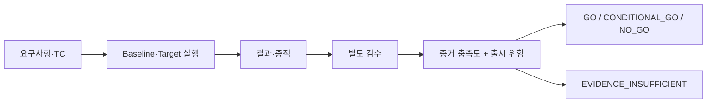

# TMS — Test Management System

**테스트 설계·실행·증적·검수와 릴리즈 품질 판단을 연결하는 QA 시스템.**

이 저장소는 **공개 합성 데이터로 전체 흐름을 재현하는 TMS 데모**와 기존 플랫폼의 설계·검증 사례를 담습니다.
Baseline·Target 실행에서 증적을 만들고, 검수를 별도 기록한 뒤, 고객 영향과 증거 충족도를 바탕으로 릴리즈 판단을 설명합니다.

[바로 실행](#바로-실행) · [심각도 기준](docs/severity-policy.md) · [실행 구조](docs/tms-architecture.md) · [기존 플랫폼 구현 사례](docs/platform-case-study.md)

## 왜 TMS로 묶었나

테스트 PASS만으로 출시 여부를 결정하기 어렵습니다. 어떤 범위를 어떤 버전에서 실행했고, 증적을 검수했는지,
확인된 결함이 사용자에게 어떤 피해를 주는지와 복구 준비까지 이어져야 합니다.



| 기능 | 역할 | 현재 공개 실행 범위 |
| --- | --- | --- |
| 테스트케이스 | 범위·기대결과·중요도 정의 | 전체 알림 조회 / 경고 필터 두 TC |
| Baseline | 기존 핵심 흐름 회귀 | 전체 6건 조회 조건 검사 |
| Target | 변경 기능 검증 | 경고 2건과 각 행의 심각도 검사 |
| 증적 | 관찰값·판정 근거 보존 | 실제 합성 행·assertion·시각·해시 JSON |
| 검수 | 자동 판정과 검토 상태 분리 | 별도 승인/반려 기록, 실행 snapshot과 연결 |
| 결함 분류 | 고객 영향 근거로 심각도 판단 | 제안 S1/S2/S3 정책; 근거 부족은 미분류 |
| 릴리즈 게이트 | 증거와 위험에 따른 판단 | 기존 공개 게이트를 내부 모듈로 통합 |

AI 지원 분석·TC 작성과 원본 React/FastAPI 플랫폼의 구현 사례는 [기존 기록](docs/platform-case-study.md)에 설명합니다.
새 공개 데모는 외부 AI·운영 API·DB 없이 실행됩니다. 과거 화면은 원본 플랫폼의 역사적 사례이며 새 데모 UI가 아닙니다.

## 바로 실행

Python **3.11 이상**으로 이 저장소 루트에서 실행합니다. 데모 실행에는 외부 패키지나 별도 저장소 checkout이 필요하지 않습니다.

```bash
python -m tms demo
```

명령은 네 시나리오를 실행하고, 실행 시각별 `reports/tms-demo-.../`에 증적·검수 기록·판정·요약을 저장합니다.
demo의 승인은 **가상 검수자에 의한 시뮬레이션**이며 실제 사람의 승인이나 제품 품질 실적이 아닙니다.

| 시나리오 | 실행한 조건 | 검수 후 판정 |
| --- | --- | --- |
| go | 전체 6건 → 경고 2건; 개수·내용 일치 | GO |
| conditional | 필터 결함 주입: 경고 조회에 6건 반환. S2 + high 실패 | CONDITIONAL_GO, 27점 |
| no_go | 핵심 조회 결함 주입: 0건 반환. S1 + critical 실패 | NO_GO |
| insufficient | Target에 가상 환경 장애 주입 | EVIDENCE_INSUFFICIENT |

실행 전 작성한 기대결과를 합성 행의 개수·내용과 코드로 비교합니다. 정적 PASS 기록을 그대로 표시하는 데모가 아닙니다.
초기 검수는 pending입니다. 확인된 S1은 검수 전에도 NO_GO이고, 그 외 미검수 결과는 증거 부족으로 보류됩니다.
demo 명령은 네 기대 판정을 재현하면 종료 코드 0입니다. **CI 초록색은 데모 검증 성공이며 배포 허가가 아닙니다.**

## 실행과 검수를 직접 나누어 보기

```bash
python -m tms run --scenario go --output-dir reports/my-run-001
python -m tms gate --run-dir reports/my-run-001 --strict
```

두 번째 명령은 미검수이므로 종료 코드 **2**로 보류합니다. 증적 JSON을 읽고 로컬 검수를 기록합니다.

```bash
python -m tms review --run-dir reports/my-run-001 --case BASE-001 --reviewer "Demo reviewer" --decision approved --note "합성 전체 조회 증적 확인"
python -m tms review --run-dir reports/my-run-001 --case TARGET-001 --reviewer "Demo reviewer" --decision approved --note "합성 경고 필터 증적 확인"
python -m tms gate --run-dir reports/my-run-001 --strict
```

변경이 없고 두 검수가 유효하면 GO / 종료 코드 0입니다. 반려는 `--decision rejected`로 기록합니다.
증적이 누락·변조되거나 승인 후 실행 내용이 바뀌면 보류합니다. 실행 폴더는 덮어쓰지 않으므로 재실행에는 새 이름을 사용하세요.
로컬 검수자 이름은 인증되지 않으며 SHA-256은 인증 서명이 아닙니다.

## 심각도와 출시 판단

**심각도는 고객 영향, 처리 우선순위는 일정**입니다. `priority`가 낮아도 중대 피해의 심각도를 낮추지 않습니다.

| 분류 | 제안 기준 | 게이트 연결 |
| --- | --- | --- |
| S1 | 확인된 데이터 유실·보안 침해·잘못된 금전 처리, 또는 우회 없는 핵심 업무 차단 | 미해결이면 NO_GO |
| S2 | S1 피해 없이 주요 기능 손상, 또는 검증된 우회가 있는 핵심 업무 차단 | 최소 조건부 대상 |
| S3 | 기능·데이터·보안·금전 영향 없이 경미한 표시·사용성 문제만 있음 | 잔여 위험 점수에 기여 |
| 분류 미완료 | 확인되지 않은 영향·근거 누락·모순 | 증거 부족으로 보류 |

분류에는 영향 사실·범위·증적·분류자·사유가 필요합니다. 기존 엔진의 P1/P2/P3 계약에는 S1/S2/S3를 명시적으로 변환합니다.
QA·운영 승인, 롤백 테스트, 모니터링 담당자·롤백 기준과 유효한 조건부 수용도 별도로 확인합니다.
기본 점수 20/45 경계·증거 유효기간 24시간은 **조정 가능한 제안**입니다. 보편적인 품질 기준이나 운영 데이터로 보정한 확률이 아닙니다.
[정확한 분류 규칙과 한계](docs/severity-policy.md)를 먼저 확인하세요.

`gate --strict` 종료 코드: **0 GO / 1 NO_GO / 2 증거 부족 / 3 조건부 수동 보류 / 4 설정 오류**.
조건부 판정에도 담당자·보강 조치·만료 시각이 있는 수용 기록이 필요하고 자동 배포는 허용하지 않습니다.

## 구조와 검증

```text
tms/                     공개 실행·검수·심각도·게이트 연결
modules/release_gate/     공개 게이트 엔진·기존 샘플·회귀 테스트
tests/                   TMS 통합·영향 분류·보류 테스트
docs/                    현재 정책·구조와 기존 플랫폼 사례
assets/                  기존 공개 캡처·검증 기록
```

```bash
python -m pip install -r requirements-dev.txt
python -m pytest -q
```

기존 게이트 검사와 TMS 실행·분류·검수·변조·만료·CLI 검사를 함께 실행합니다.
[TMS Integration CI](.github/workflows/release-gate-demo.yml)는 네 실행과 이전 JSON/CSV 계약의 기대 판정을 검증하고 보고서를 보관합니다.
예상된 NO_GO는 검증 성공으로 처리하므로 TMS CI의 실패 알림과 혼동하지 않습니다.

기존 [qa-release-gate](https://github.com/tempesty-ai/qa-release-gate)는 출처와 이력을 유지합니다.
[고정 소스 출처](modules/release_gate/UPSTREAM.md) · [이전 연동에서 달라진 점](docs/release-gate-integration.md)

## 공개 범위

제품·사용자·결함·승인·시각·후보 SHA는 공개용 가상 값입니다. 이 공개 데모를 위해 독립 작성한 TMS 흐름과
기존 **공개** 게이트 소스만 포함합니다. 회사 원본 소스·실제 이슈·운영 데이터·인증정보는 포함하지 않습니다.
실행은 인메모리 합성 제품 검사이며 실제 서비스 실행·사용자 인증·DB·브라우저 E2E·운영 롤백을 검증하지 않습니다.
처리 시간 단축률·결함 발견률·운영 품질 개선 수치는 아직 측정하지 않았습니다.
