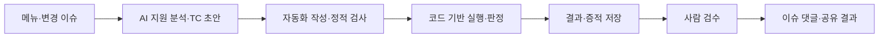
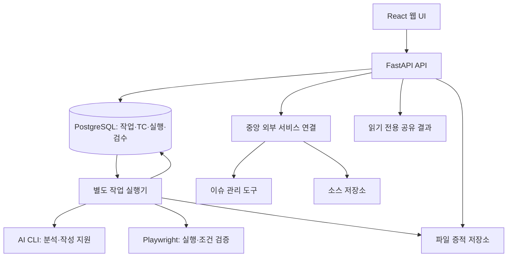
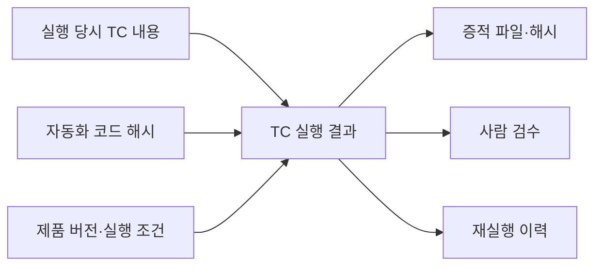

# AI-assisted QA Workflow Platform

**전체 회귀는 Baseline으로, 테스트 대기 이슈는 Target으로.**

이슈트래커에서 테스트 대기 상태의 이슈를 골라, **여러 건의 분석·TC 작성·자동화 실행을 일괄 요청하고 진행 상태와 결과를 한곳에서 확인**하는 QA 플랫폼입니다. AI가 이슈·소스 근거를 테스트 초안과 자동화 코드로 연결하고 실패 분석을 도와, 담당자가 검증 범위와 결과 검토에 집중하도록 설계했습니다.

[만든 이유](#왜-만들었나) · [Baseline과 Target](#baseline과-target) · [화면으로 보는 흐름](#화면으로-보는-흐름) · [주요 기능](#목적을-기능으로-연결) · [구현 사례](#구현-사례) · [아키텍처](#아키텍처와-기술-구성) · [설계 결정](#설계-결정과-비용) · [검증 기록](#검증-기록) · [AI 활용과 작업 범위](#ai-활용과-작업-범위)

## 왜 만들었나

변경 이슈 한 건을 검증할 때도 할 일은 많습니다. 변경 내용을 읽고, 테스트케이스를 작성하고, 실행한 뒤, 증적을 정리해 결과를 전달해야 합니다. 문서·자동화 코드·실행 기록·스크린샷이 분리되어 있으면 담당자가 매번 그 사이를 연결해야 합니다. 결과를 받는 사람도 무엇을 어떤 기준으로 확인했는지 다시 찾아야 합니다.

이 프로젝트는 **메뉴 회귀 테스트와 변경 이슈 검증을 반복하는 QA 담당자**, 그리고 **그 결과를 확인하는 개발자·검토자**를 위해 만들었습니다. 목표는 이슈에서 검증 근거가 담긴 결과까지 이어지는 반복 작업을 줄여, 담당자가 테스트 범위와 품질 판단에 집중하도록 하는 것입니다.

이를 **반복해서 확인할 기능 기준**과 **지금 검증할 변경 이슈**로 나눴습니다. 반복 판정은 코드가 수행하고, 최종 검수는 사람이 맡습니다.

## Baseline과 Target

공개 후속 데모: [Baseline·Target 증거 → 릴리즈 품질 게이트](docs/release-gate-integration.md).
합성 결과를 [qa-release-gate](https://github.com/tempesty-ai/qa-release-gate)에 전달해
**증거 충족도와 출시 위험을 별도 평가**합니다. `GO / CONDITIONAL_GO / NO_GO`와
`EVIDENCE_INSUFFICIENT`를 구분하는 제안 정책이며, 기본 경계 20/45점은 조정 가능한 초안입니다.
회사 소스·운영 연동을 포함하지 않는 독립 데모이고, GitHub Actions는 합성 입력의 예상 판정과 보고서 생성을 검증합니다.

| 구분 | Baseline TC · 전체 회귀 검증 | Target TC · 대기 이슈 검증 |
|---|---|---|
| 목적 | 제품의 기존 기능을 폭넓게 다시 확인하는 Full TC 회귀 구성 | 이번 변경·수정이 요구사항을 만족하는지 이슈별 확인 |
| 출발점 | 메뉴·기능별로 축적한 TC | 이슈트래커에서 테스트 대기에 해당하는 상태로 필터링한 이슈 |
| 실행 흐름 | 등록된 메뉴 TC를 테스트 묶음으로 구성해 반복 실행 | 여러 이슈 선택 → 분석·TC 작성 → 자동화 작성·실행을 일괄 요청 |
| 확인할 결과 | 선택한 회귀 범위의 판정·증적·이력 | 이슈별 진행 상태·TC 결과·남은 검수 |

Baseline은 등록된 TC를 모아 전체 회귀 범위를 구성하는 용도입니다. 실제 실행에는 자동화 연결과 준비 조건을 충족한 TC를 사용하며, 필요한 메뉴만 골라 실행할 수도 있습니다.

### Target에서 오늘 검증할 이슈를 처리하는 흐름

**대기 상태로 필터링 → 여러 이슈 선택 → AI 분석·TC·자동화 작성 → 테스트 실행 → 결과·검수 상태 확인**

1. **지금 테스트할 이슈만 모읍니다.** 연결한 이슈트래커 목록에서 팀이 쓰는 대기 상태를 선택하고, 담당자·진행 상태·검수 상태로 범위를 더 좁힙니다.
2. **여러 건을 고르고 처리 범위를 정합니다.** 분석·TC 작성까지, 자동화 코드 작성까지, 실제 실행까지 중 필요한 단계를 일괄 요청합니다. 배포 확인과 실행 준비 조건에 따라 항목별로 진행합니다.
3. **서로 다른 이슈의 분석·자동화 작성을 병렬 처리합니다.** 같은 제품 계정을 쓰는 실제 테스트는 서로 영향을 주지 않도록 순차 실행합니다.
4. **진행 상황을 목록에서 계속 확인합니다.** 이슈 상태와 테스트 진행·결과·검수 상태를 함께 표시하고 자동 갱신합니다. 증적을 검수한 뒤 이슈 댓글과 결과 링크로 공유할 수 있습니다.

AI는 이슈와 소스를 읽어 초안을 준비하고, 그 초안을 자동화 코드로 옮기는 작업을 지원합니다. 이슈를 한 건씩 열어 작업을 시작하고 진행 기록을 다시 모으는 부담을 줄이는 것이 이 흐름의 목적입니다. 자동 갱신 주기와 상태 연동의 적용 범위는 [구현 범위 확인](#baseline과-target-구현-범위-확인--2026-10-14)에 정리했습니다.

## 화면으로 보는 흐름

**[① TC 설계](#1-tc-설계) → [② 실행 결과](#2-실행-결과와-검수) → [③ 증적·공유](#3-증적-확대와-공유) → [④ 실패·복구](#4-조회-실패에서-복구까지)**

로컬 소스의 UI에 공개용 가상 데이터를 연결하고 Computer Use로 촬영했습니다. **전체 알림 6건 → 경고 2건 → 전체 6건 복구**라는 테스트 한 건을 따라가며 각 화면의 역할을 소개합니다.

> 화면의 제품명·사용자·이슈·TC·실행 기록은 공개용 예시입니다. 샘플 알림 화면의 필터 동작은 코드로 검사했으며, 플랫폼에 표시된 PASS는 가상 실행 기록입니다. 실제 제품의 통과 실적이나 사람 검수 완료를 뜻하지 않습니다.

### 1. TC 설계


사전조건에는 데이터의 개수와 구성을, 절차에는 조작과 기대결과를 짝으로 적었습니다. 오른쪽 실행 이력에서 해당 TC의 결과 카드로 이동할 수 있습니다.

| 순서 | 조작 | 기대결과 |
|---|---|---|
| 1 | 전체 알림 조회 | 6건 표시 |
| 2 | 경고 필터 선택 | 경고 2건만 표시, 표시 건수도 2 |
| 3 | 전체로 복구 | 다시 6건 표시 |

**핵심은 현재 TC와 실행 당시 문서를 구분하는 것**입니다. 문서를 수정한 뒤에도 과거 결과가 어떤 절차를 기준으로 나왔는지 확인할 수 있어야 합니다.

### 2. 실행 결과와 검수


자동 판정은 통과여도 검수 줄에는 **미검수**가 표시됩니다. 자동화가 조건을 만족한 것과 담당자가 증적을 확인한 것을 별도 상태로 관리합니다.

왼쪽의 두 번째 증적과 오른쪽 2단계의 기대결과를 비교하고, 입력·기대·실제 관찰 기록을 펼쳐 판정 근거를 읽을 수 있습니다.

### 3. 증적 확대와 공유


증적을 확대하면 `경고` 선택값, `2건 표시`, 두 행의 심각도를 함께 읽을 수 있습니다. 보라색·회색 경계는 관찰할 영역을 표시합니다. 샘플 검사는 **행 개수와 각 행의 심각도**를 함께 비교하도록 작성했습니다.


결과를 전달받은 사람은 **한 카드 안에서 증적과 절차·기대결과·판정을 비교**할 수 있습니다. 기존 이슈 댓글 형식을 유지하면서 링크로 여는 화면을 개선했습니다. 썸네일·이전/다음·확대를 제공하는 읽기 전용 화면입니다.

<details>
<summary>같은 공유 화면의 라이트 테마 보기</summary>


</details>

### 4. 조회 실패에서 복구까지


목록에서 제목을 받았더라도 상세 본문을 읽지 못하면 조회 실패를 표시합니다. 안내와 재시도 버튼을 제공하고, 본문을 확보하기 전까지 AI 분석 시작을 제한합니다.


Computer Use로 `본문 다시 불러오기`를 누르고 가상 API가 정상 응답하는 흐름을 확인했습니다. 오류 안내가 사라지고 본문과 활성화된 분석 버튼이 표시됩니다. AI 분석 자체는 시작하지 않았습니다.

두 이미지는 **동일한 구현의 실패 상태와 복구 상태**를 보여 줍니다.

## 목적을 기능으로 연결

각 단계에서 만든 정보가 다음 단계의 근거가 되도록 연결했습니다. 예를 들어 TC를 수정한 뒤에도 과거 결과에는 실행 당시 문서를 남기고, 자동 판정이 통과여도 사람의 검수 여부는 별도로 표시합니다. 결과를 확인하는 사람이 검증 범위와 남은 일을 구분할 수 있도록 한 구성입니다.



| 영역 | 구현 내용 | 해결하려는 문제 |
|---|---|---|
| 회귀 검증 | Baseline 메뉴 TC를 모아 전체 또는 선택 범위의 회귀 테스트 구성 | 반복 검증할 기능 기준을 매번 다시 구성함 |
| 이슈 검증 | Target 목록에서 대기 상태·담당자 등으로 필터링하고 여러 이슈 일괄 처리 | 지금 검증할 이슈를 찾아 건별로 작업을 시작함 |
| AI 지원 | 이슈·소스 근거 분석, TC 초안과 자동화 코드 작성·검토 지원 | 초기 분석과 작성에 반복 작업이 많음 |
| 처리와 상태 반영 | 이슈별 분석·작성 병렬 처리, 공유 계정 테스트 순차 실행, 진행·결과·검수 상태 자동 갱신 | 여러 작업의 진행과 확인할 결과를 따로 추적함 |
| 선택 실행 | TC별 실행 연결과 준비 상태를 확인하고 필요한 항목 실행 | 일부 검증을 전체 완료로 오해함 |
| 결과 추적 | 실행 당시 문서·코드 해시·제품 버전·판정·증적 연결 | 과거 결과의 근거가 현재 문서와 섞임 |
| 검수 | 자동 판정과 사람의 검수 상태 분리 | 미실행·미확인을 통과로 취급함 |
| 공유 | 이슈 댓글 요약과 증적·절차를 함께 보는 읽기 전용 화면 | 다른 담당자가 판정 근거를 찾기 어려움 |
| 운영 | API와 작업 실행기 분리, 외부 서비스 연결 중앙 관리 | 긴 작업과 웹 요청의 수명이 섞임 |

## 구현 사례

화면 개선뿐 아니라 **문제를 어떻게 좁혔고, 어떤 조건으로 확인했는지**를 함께 정리했습니다.

### 1. 결과를 다시 판단할 수 있는 공유 화면

**문제:** 공유 링크 안에서 절차와 이미지를 따로 찾아야 해 증적과 기대결과의 대응 관계를 읽기 어려웠습니다. 댓글 형식과 결과 저장 계약을 유지하면서 링크로 여는 화면을 개선하는 범위로 정했습니다.

| 구현 선택 | 이유 | 고려한 비용 |
|---|---|---|
| TC별 카드와 두 열 구성 | 증적과 기대결과를 같은 위치에서 비교 | 화면 폭에 따른 공간 배분 |
| 썸네일·이전/다음·원본 크기 확대 | 여러 촬영을 맥락 안에서 확인 | 선택 상태와 키보드 포커스 관리 |
| 실행 당시 문서 표시 | 문서 변경 후에도 과거 판정 근거 유지 | 당시 문서가 없을 때 별도 안내 |
| 게시 범위의 결과·증적만 표시 | 전달받은 사람이 필요한 근거를 조회 | 별도 공유 화면과 접근 범위 유지 |

**검증:** 출력 문자열의 HTML 이스케이프, 게시 범위의 이미지 경로, 허용 스크립트의 정확한 해시를 검사했습니다. PC 폭 4종과 두 테마에서 이미지 전환·확대·키보드 닫기·포커스 복귀를 확인했습니다.

### 2. 빈 본문과 조회 실패를 구분하는 상태 처리

**문제:** 목록 조회와 본문 조회는 별개입니다. 제목만 확보한 상태를 본문까지 확보한 것으로 취급하면 사용자에게 빈 문서처럼 보이고, AI 분석의 입력 근거도 부족해집니다.

```text
본문 조회 중
  ├─ 성공 → 본문 표시 → 분석 가능 여부 판단
  └─ 실패 → 조회 실패 안내 + 다시 불러오기 → 분석 제한
                 └─ 재시도 성공 → 오류 해제 + 본문 표시
```

**구현:** 실패 안내·재시도·펼쳐 보는 상세 오류를 제공하고, 본문 확인 전에는 분석 시작을 제한했습니다. 서버의 구버전 호환 처리도 특정 미지원 조회에 한정해 인증·권한·네트워크 오류를 임의로 우회하지 않도록 했습니다.

**검증:** 실패 응답과 정상 응답을 순서대로 반환하는 가상 API로 오류 표시 → 재시도 → 본문 복구를 검사했습니다. 두 제품의 이슈·런 화면 이동과 복귀도 함께 확인했습니다.

### 3. 회귀 검사 자체의 요청 가로채기 오류 수정

**관찰:** 가상 API를 연결한 검사에서 화면이 비어 보였습니다. 대기 시간을 늘리기 전에 실제 요청을 확인했고, API 응답을 대체하는 규칙이 프런트엔드 JavaScript 모듈까지 가로채고 있음을 찾았습니다.

```text
넓은 규칙: **/api/**
  → /src/shared/api/... 같은 화면 코드 경로까지 일치할 수 있음

제한한 규칙: <검사 대상 origin>/api/**
  → 해당 서버의 실제 API 경로만 가로챔
```

**수정과 확인:** 가로채기 범위를 서버의 API 경로로 좁힌 뒤 화면 전환·재시도를 검사하고, 페이지 오류와 변경 요청이 없는지 확인했습니다. 실패 원인을 제품·자동화 코드·검사 환경으로 나눠 분석한 사례입니다.

## 아키텍처와 기술 구성



구성 요소 사이의 논리적 연결입니다. API는 작업을 접수하고 상태·결과를 제공하며, 오래 걸리는 분석·자동화 작성·실행은 별도 실행기가 맡습니다. 대기·실행·중단 상태를 구분하도록 구성했습니다.

| 계층 | 기술 |
|---|---|
| 웹 UI | React · TypeScript · Vite · React Query |
| API | Python · FastAPI |
| 작업 실행 | 별도 Python 실행기 · AI CLI 연결 |
| 테스트 자동화 | Playwright · DOM·요청응답 assertion |
| 결과·증적 | PostgreSQL · 파일 저장소 · SHA-256 |
| 외부 연결 | 이슈 관리·소스 저장소 API · 암호화된 연결 정보 |

### 실행 근거와 결과의 연결



현재 문서가 바뀌어도 과거 실행의 절차를 설명할 수 있도록 당시 근거를 연결합니다. 재실행은 새 기록으로 관리하고, 증적 파일은 저장 장치의 절대 경로와 분리된 상대 경로로 관리합니다. SHA-256은 파일 일치 여부를 확인하는 근거이며 테스트의 정확성은 조건 비교와 증적 검수로 판단합니다.

외부 서비스 연결은 소유자·제품 접근 권한·허용된 조회 형식을 확인합니다. 읽기 전용 공유 화면은 게시한 결과와 증적의 범위 안에서 표시합니다.

## 설계 결정과 비용

| 결정 | 얻는 점 | 함께 관리해야 하는 비용 |
|---|---|---|
| API와 작업 실행기 분리 | 웹 요청과 긴 작업의 수명을 분리하고 API 재시작의 영향을 줄임 | 작업 상태·실행 주체·중단과 복구 처리 |
| 실행 당시 문서·코드 해시·버전 보존 | 나중에도 당시 판정 근거를 설명 | 기록 크기와 버전 관리 부담 |
| 자동 판정과 사람 검수 분리 | 완료 상태의 의미를 명확히 전달 | 상태 표시·필터·게시 조건의 복잡성 |
| 읽기 전용 공유 화면 제공 | 전달받은 사람이 필요한 결과에 집중 | 공유 범위·접근 경계·출력 처리 유지 |
| 반복 회귀를 코드로 수행 | 판정 조건과 관찰값을 일관되게 비교 | assertion·가상 응답 유지, 테스트 코드 오류 분석 |
| 분석·작성은 병렬, 공유 계정 실행은 순차 처리 | 여러 이슈의 준비를 함께 진행하면서 테스트 간 간섭을 줄임 | 이슈별 작업 소유권과 실행 대기 상태 관리 |

별도 실행기가 모든 장애 복구를 보장하지는 않습니다. 다중 실행기의 동시 처리 성능과 모든 장애 상황은 검증 범위에 포함하지 않았습니다.

## 검증 기록

**로컬 소스에서 확인한 구현, 원본 프로젝트의 실행 검증, 공개용 촬영 환경 검증을 구분**했습니다. 아래 수치는 각각의 확인 범위에 해당합니다.

### Baseline과 Target 구현 범위 확인 · 2026-10-14

| 항목 | 로컬 소스에서 확인한 구현 |
|---|---|
| Baseline 회귀 구성 | 메뉴별 TC 선택·그룹 담기, 테스트 묶음과 실행 계획, TC별 실행 준비 상태 확인 |
| Target 필터·일괄 처리 | 제품별 조회 범위 안에서 상태·담당자·진행·검수 필터, 여러 이슈 선택, 분석·작성·실행 단계 선택 |
| 화면 상태 자동 갱신 | 보이는 목록의 진행·결과·검수 상태를 5초 주기로 조회. 일괄 작업 내역은 3초 주기로 조회 |
| 외부 이슈 상태 조회 | 이슈트래커 목록은 기본 120초 캐시와 갱신 구조를 사용하고 수동 새로고침 제공. 화면 조회 주기와 외부 데이터 갱신 주기는 별도 |
| 병렬 처리 범위 | 서로 다른 이슈의 분석·자동화 작성은 병렬 처리. 일괄 작업의 실제 실행은 순차 처리하며, 동일 제품 계정의 실행 중복은 별도 잠금으로 제한 |
| 자동 시작·외부 상태 변경 | 지정 상태 감지 후 자동 시작과, 검수 후 결과 게시에 따른 완료·재오픈 상태 반영은 현재 데모 목록에 한정 |

이 절은 코드에서 확인한 동작 범위를 설명합니다. 이번 문서 보완에서는 실제 이슈 변경·일괄 실행·병렬 성능 검증을 새로 수행하지 않았습니다. 아래 공개용 캡처는 TC·결과·증적 화면을 보여 주며, 대기 이슈 필터와 병렬 처리의 실행 증적은 포함하지 않습니다.

### 공개용 화면 촬영 · 2026-10-13

| 구분 | 확인한 내용 |
|---|---|
| 소스 기반 화면 | 로컬 React UI 사본 빌드, 로컬 공유 결과 렌더러 실행 |
| 데이터 | 가상 제품·이슈·TC·실행 기록과 별도로 만든 샘플 알림 6건 |
| 샘플 자동 검사 | 전체 6건 → 경고 2건 및 심각도 일치 → 전체 6건 복구 |
| UI 자동 검사 | TC·결과·공유 화면, 증적 전환·확대·닫기, 오류·재시도 |
| 검사 관찰 | 해당 자동 검사에서 페이지 오류 0건, 외부 요청 0건, 데이터 변경 요청 0건 |
| Computer Use | 실행 이력 이동, 증적 선택·확대·닫기, 공유 테마 전환, 본문 재시도와 화면 7장 촬영 |

[자동 검사 요약 JSON](assets/capture-verification.json)에서 확인 항목과 관찰값을 볼 수 있습니다. 화면 7장은 자료의 수이며 제품 TC 통과 수가 아닙니다. 캡처의 실행 시각·ID는 고정된 예시 값입니다.

촬영 환경은 별도 임시 소스 사본에 공개용 표시 이름·로고를 적용하고 외부 폰트 요청을 제거해 구성했습니다. 실제 API·DB·이슈 서비스와 연결하지 않았고, 로컬 캡처 서버는 데이터 변경 요청을 거절하도록 했습니다. DB 저장·실제 제품 실행·사람 검수·외부 댓글 게시를 수행하지 않았습니다.

### 원본 프로젝트 검증 · 2026-10-08

| 대상 | 검증 범위 |
|---|---|
| 공유 화면 출력 | 3건: 이스케이프·읽기 전용 구성, 게시 범위 이미지 경로, 허용 스크립트 해시 |
| 화면 크기·테마 | 1920×1080, 1536×864, 1366×768, 1280×720 × 라이트·다크 |
| 증적 상호작용 | 썸네일·이전/다음, 원본 크기 확대, 열기·닫기, 포커스 복귀. 실제 공유 사례 한 장과 별도 두 장 가상 데이터를 구분 |
| 이슈·런 이동 | 두 제품에서 이동·복귀·새로고침·별도 페이지 진입 확인 |
| 본문 조회 | 실패 안내·분석 제한·재시도·성공 후 본문 표시 |
| UI 검사 관찰 | 가상 API를 사용하는 화면 캡처 24개, 해당 검사에서 외부 변경 요청·페이지 오류 0건 |
| 외부 연결·댓글 | 가짜 전송·DB 호출로 조회 경로·권한 범위·구버전 호환·댓글 처리 회귀 검사 |
| 정적·구조 검사 | 폴더 의존 방향, TypeScript, Vite 빌드, QA 패키지 필수 경로·연결과 증적 규격 검사 |

모바일 사용성과 모든 접근성 항목은 확인 범위에 포함하지 않았습니다. 가상 API·정적 검사와 별개로 실제 제품 검증에는 메뉴별 실행 결과와 증적 검수 근거가 필요합니다.

처리 시간 단축률·결함 발견률은 아직 측정하지 않았습니다. 성과 수치를 추가할 때는 비교 대상, 표본 수, 기간, 환경과 측정 방법을 함께 기록할 계획입니다.

## AI 활용과 작업 범위

**QA 자동화·플랫폼 개발**과 **AI를 활용한 개발 과정**을 함께 보여 주는 기록입니다. AI를 요구사항 정리, 코드 작성, 실패 분석과 검증 보조에 활용하고, 범위·제약과 확인 근거를 문서에 남겼습니다.

| 단계 | 역할 | 남기는 근거 |
|---|---|---|
| 분석·TC 초안 | 사람이 범위·제약 설정, AI가 분석·작성 지원 | 이슈·소스 근거, 절차·기대결과 |
| 자동화 작성 | AI 지원과 코드 검토·정적 검사 | TC와 자동화 연결 |
| 반복 실행 | 코드의 조건 비교 | assertion·요청응답·관찰값 |
| 결과 저장 | 실행·발행 코드 | 판정·버전·해시·증적 |
| 검수 | 사람의 확인과 판단 | 검수 결정·메모 |

작성 완료·실행 완료·검수 완료를 별도 상태로 다루고, 실패를 제품 결함·자동화 오류·환경 문제·데이터 부족으로 구분합니다. 미실행·미확인을 통과로 기록하지 않는 원칙입니다.

이 자료에서 구체적으로 다룬 변경은 **공유 결과 화면 개선, 이슈 본문 실패·재시도 처리, 관련 회귀 검사 보완**입니다. 플랫폼 전체의 단독 개발이나 모든 메뉴의 검증 완료를 주장하지 않으며 개인별 기여율은 확인되지 않아 제시하지 않습니다.

### 다음 기록

- 범용 TC 한 건을 재현하는 최소 실행 데모
- 사례별 개인 기여와 협업 범위
- 실제 기준으로 측정한 테스트 준비·검수 소요 시간

---

이 저장소는 설계와 구현 사례를 소개하는 문서 포트폴리오입니다. 공개 가능한 설명·캡처·검사 요약을 보관하며, 원본 운영 코드·임시 빌드·실제 이슈·제품 데이터·인증정보는 포함하지 않습니다. 원본 검사 코드를 포함하지 않아 이 저장소에서 해당 검사를 바로 재실행할 수는 없습니다.

2026-10-16 추가: [공개 합성 증거 데모](docs/release-gate-integration.md)는 별도 재현 가능합니다.
고정된 공개 게이트 커밋을 사용하며, 위 원본 플랫폼 검사와 공개용 화면 촬영 검사를 대체하지 않습니다.

기록 시작·공개용 화면 촬영: **2026-10-13** · Baseline·Target 구현 범위 확인: **2026-10-14** · 원본 검증 사례 기준: **2026-10-08**
