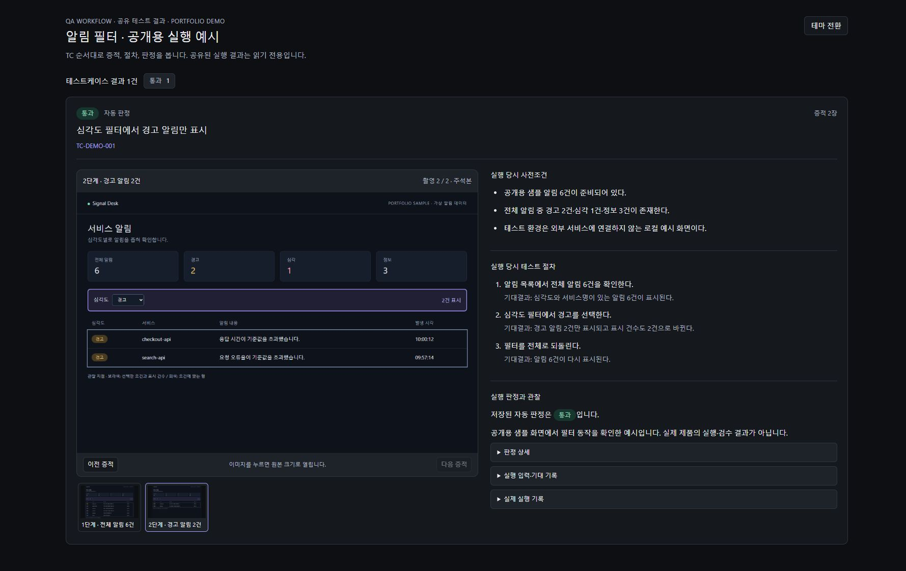
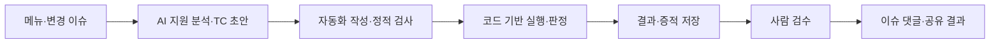

# AI-assisted QA Workflow Platform

**테스트 설계부터 자동화 실행, 증적 검수와 결과 공유까지 연결한 QA 플랫폼의 설계·구현 기록.**

## 화면으로 보는 흐름

**[① TC 설계](docs/walkthrough.md#1-tc-설계) → [② 실행 결과](docs/walkthrough.md#2-실행-결과와-검수) → [③ 증적·공유](docs/walkthrough.md#3-증적-확대와-공유) → [④ 실패·복구](docs/walkthrough.md#4-조회-실패에서-복구까지)**

로컬 구현에 공개용 가상 데이터를 넣어 Computer Use로 촬영했습니다. 아래 공유 화면에서 테스트 한 건의 증적, 절차와 판정을 함께 확인할 수 있습니다.

<picture>
  <source media="(prefers-color-scheme: dark)" srcset="assets/screenshots/04-shared-result-dark.jpg">
  <source media="(prefers-color-scheme: light)" srcset="assets/screenshots/05-shared-result-light.jpg">
  
</picture>

| 단계 | 화면에서 확인할 수 있는 것 |
|---|---|
| [① TC 설계](docs/walkthrough.md#1-tc-설계) | 사전조건·절차·기대결과와 실행 이력 연결 |
| [② 실행 결과](docs/walkthrough.md#2-실행-결과와-검수) | 자동 판정과 사람 검수의 분리, 실행 당시 문서 |
| [③ 증적·공유](docs/walkthrough.md#3-증적-확대와-공유) | 촬영 전환·확대, 읽기 전용 공유, 라이트·다크 테마 |
| [④ 실패·복구](docs/walkthrough.md#4-조회-실패에서-복구까지) | 본문 조회 실패 안내, 분석 제한, 재시도 후 정상 표시 |

**[화면 7장으로 전체 과정 보기 →](docs/walkthrough.md)**

예시는 **전체 알림 6건 → 경고 2건 → 전체 6건 복구** 시나리오입니다. 샘플 화면의 필터 조건은 코드로 검사했고, 플랫폼의 기록은 설명을 위해 구성한 fixture입니다. 실제 제품의 통과·검수 실적을 나타내지 않습니다.

[구현 포인트](docs/engineering-notes.md) · [아키텍처](docs/architecture.md) · [개선 사례](docs/case-studies.md) · [설계 결정](docs/decisions.md) · [검증 범위](docs/verification.md)

> 이 저장소는 프로젝트 사례를 설명하는 문서 포트폴리오입니다. 실행 가능한 애플리케이션 배포본이 아니며, 원본 운영 코드·실제 이슈·제품 데이터·인증정보는 포함하지 않습니다.

## 프로젝트 배경

테스트케이스 문서, 자동화 코드, 실행 결과, 스크린샷, 이슈 관리 도구가 분리되어 있으면 다음 질문에 답하기 어렵습니다.

- 어떤 요구사항과 절차로 테스트했는가?
- 현재 문서와 실제 실행 당시 문서가 같은가?
- 실패 원인이 제품 결함인지, 자동화 오류인지, 환경 문제인지 구분되는가?
- 통과 판정을 뒷받침하는 증적을 다른 사람이 확인할 수 있는가?
- AI가 만든 초안과 검증을 마친 결과를 구분할 수 있는가?

이 프로젝트는 **테스트케이스 → 실행 당시 근거 → 자동 판정 → 사람 검수 → 공유 결과**를 연결하는 데 초점을 맞췄습니다.

AI는 이슈 분석과 테스트케이스·코드 작성을 지원하고, 자동화 코드는 반복 실행과 조건 비교를 수행하며, 사람은 결과와 증적을 검수합니다. 이 역할 분리를 웹 플랫폼과 실행 파이프라인에 어떻게 반영했는지 정리했습니다.

## 전체 흐름

## 주요 기능

| 영역 | 구현 내용 | 해결하려는 문제 |
|---|---|---|
| 테스트 설계 | 메뉴 기능 기준·이슈 변경 기준 TC 구분, 절차·기대결과 관리 | 테스트 의도와 범위가 불명확한 문제 |
| AI 지원 | 이슈·소스 근거 분석, TC 초안과 자동화 코드 작성·검토 지원 | 초기 분석과 작성에 반복적으로 드는 작업 |
| 선택 실행 | TC별 실행 연결과 준비 상태를 확인하고 필요한 항목 실행 | 일부 검증을 전체 완료로 오해하는 문제 |
| 결과 추적 | 실행 당시 문서·코드 해시·제품 버전·판정·증적 연결 | 과거 결과의 근거가 현재 문서와 섞이는 문제 |
| 검수 | 자동 판정과 사람의 검수 상태 분리 | 미실행·미확인을 통과로 취급하는 문제 |
| 공유 | 이슈 댓글의 결과 요약, 증적과 절차를 함께 보는 읽기 전용 화면 | 결과를 다른 담당자가 다시 확인하기 어려운 문제 |
| 운영 | API와 작업 실행기 분리, 외부 서비스 연결 중앙 관리 | 오래 걸리는 작업과 웹 요청의 수명이 섞이는 문제 |

## 기술 구성

| 계층 | 기술 |
|---|---|
| 웹 UI | React · TypeScript · Vite · React Query |
| API | Python · FastAPI |
| 작업 실행 | 별도 Python 실행기 · AI CLI 연결 |
| 테스트 자동화 | Playwright · DOM·요청응답 assertion |
| 결과·증적 | PostgreSQL · 파일 저장소 · SHA-256 |
| 외부 연결 | 이슈 관리·소스 저장소 API · 암호화된 연결 정보 |

## 대표 사례

### 증적과 절차를 함께 읽는 공유 결과 화면

절차와 큰 이미지를 세로로 나열하던 화면을 테스트케이스별 카드로 구성했습니다. 왼쪽에는 증적과 썸네일, 오른쪽에는 사전조건·절차·기대결과·판정을 배치하고 이미지 확대와 키보드 닫기, 테마 전환을 제공했습니다.

읽기 전용 공유 범위를 유지하면서 화면 구성과 상호작용을 바꾼 사례입니다. [문제·해결·검증 보기 →](docs/case-studies.md#1-공유-결과-화면의-정보-구조)

### 빈 본문과 조회 실패를 구분하는 이슈 화면

목록에서 제목을 받은 뒤 본문 요청이 실패하면 빈 본문처럼 보일 수 있었습니다. 조회 실패 안내와 다시 불러오기 동작을 추가하고, 최신 본문을 확인하지 못한 상태에서는 분석 시작을 제한했습니다.

가짜 API 응답으로 실패·복구 흐름을 재현하고 회귀 검사에 포함했습니다. [문제·해결·검증 보기 →](docs/case-studies.md#2-이슈-본문-조회-실패와-재시도)

### AI 지원 작업을 검토 가능한 단계로 구성

작성된 초안, 생성된 코드, 실제 실행, 사람 검수의 상태를 나눴습니다. 반복 판정은 코드의 assertion으로 수행하고, 실패 분류와 증적을 함께 남겨 사람이 다음 행동을 결정할 수 있도록 구성했습니다. [역할과 한계 보기 →](docs/case-studies.md#3-ai-지원과-코드-기반-판정의-역할-분리)

## 검증 기록

아래 내용은 원본 프로젝트에서 수행한 검증을 요약한 것이며, 이 문서 저장소의 CI 실행 결과가 아닙니다.

- 공유 화면: 렌더링·출력 관련 검사 3건, PC 폭 4종 × 테마 2종, 이미지 확대·닫기·포커스 복귀 확인.
- 이슈 화면: 두 제품의 이동·복귀, 본문 조회 실패와 재시도 확인. mocked UI 캡처 24개, 해당 검사에서 변경 요청과 페이지 오류 0건.
- 연결 처리: 조회 경로·권한 범위·구버전 중계 서버 호환을 가짜 전송으로 검사.
- 변경 반영: 화면 구조 검사, TypeScript 검사, Vite 빌드, QA 패키지 경로 검사 수행.

검증 단위와 실제 제품 테스트의 차이는 [검증 범위 문서](docs/verification.md)에 정리했습니다. 처리 시간 단축률이나 결함 발견률은 측정하지 않았으므로 성과 수치로 제시하지 않습니다.

## AI 활용과 기록 원칙

AI를 요구사항 정리, 코드 작성, 실패 분석과 검증 보조에 활용했습니다. 포트폴리오에서는 도구 사용 여부뿐 아니라 **문제 정의, 설계 선택, 제약 설정, 검증 근거, 반영 과정**을 함께 설명합니다.

이 기록에서 구체적으로 다루는 변경은 **공유 결과 화면 개선**, **이슈 본문 조회 실패·재시도 처리**, **관련 회귀 검사 보완**입니다. 각 변경에서 문제를 어떻게 좁혔고 어떤 조건을 검증했는지는 [구현 포인트](docs/engineering-notes.md)에 정리했습니다. 플랫폼 전체 기능의 단독 개발을 주장하지 않으며, 개인별 기여율은 확인되지 않아 제시하지 않습니다.

## 다음 기록

- 범용 TC 한 건을 재현하는 최소 데모
- 사례별 개인 기여와 설계 선택의 배경
- 실제 기준으로 측정한 테스트 준비·검수 소요 시간

기록 시작·공개용 화면 촬영: **2026-10-13** · 원본 검증 사례 기준: **2026-10-08**
