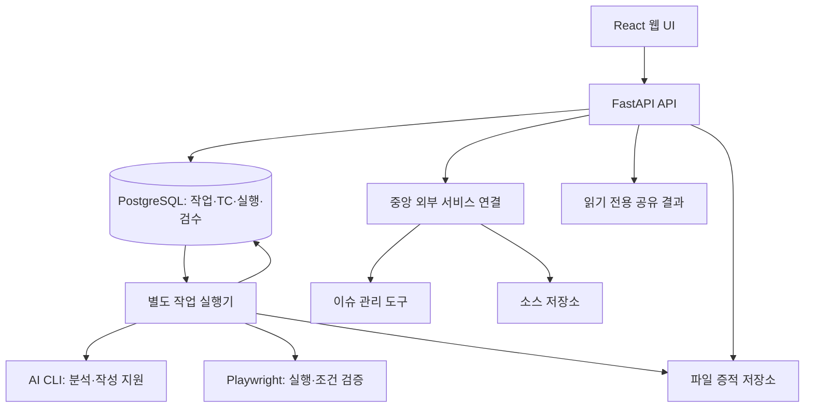
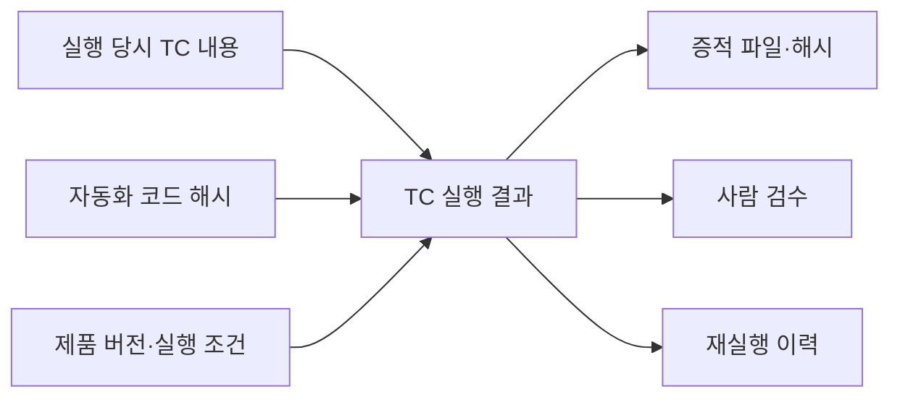

# 아키텍처

[프로젝트 소개로 돌아가기](../README.md)

## 논리 구조

구성 요소 사이의 논리적 연결을 나타냅니다. 특정 클라우드나 별도 메시지 브로커를 도입했다는 의미는 아닙니다.

## 요청과 작업의 수명

API는 요청을 접수하고 상태·결과를 제공합니다. 오래 걸리는 분석과 자동화 작성·실행은 별도 실행기가 맡습니다. 웹 요청의 수명과 작업의 수명을 분리해 API 재시작의 영향을 줄이려는 구조입니다.

대기 작업, 실행 중인 작업, 중단된 작업의 처리를 구분합니다. 모든 장애 상황이나 여러 실행기의 동시 처리 성능을 검증했다고 설명하지 않습니다.

## 결과와 증적의 연결

현재 문서가 바뀌더라도 과거 실행의 절차를 설명할 수 있도록 실행 당시 근거를 연결합니다. 재실행은 새로운 기록으로 관리하며 과거 결과를 현재 판정으로 덮어쓰지 않는 방향을 사용합니다.

증적은 저장 장치의 절대 경로와 분리된 상대 경로로 관리합니다. SHA-256은 파일의 일치 여부를 확인하는 근거이며, 절차의 정확성은 assertion과 증적 검수로 따로 판단합니다.

## 외부 서비스 연결

외부 연결은 소유자와 제품 접근 권한, 허용된 조회 형식을 확인합니다. 연결 정보는 중앙에서 관리하며 작업 PC가 필요한 조회를 요청합니다.

구버전 중계 서버 호환은 특정 미지원 조회에 한정합니다. 인증·권한·네트워크 오류를 조회 성공으로 대체하지 않습니다.

## 공유 화면

게시한 결과의 범위 안에서 테스트케이스와 증적을 표시합니다. 읽기 전용 결과 화면은 검수 작업 화면과 구분합니다. 이미지 전환과 확대는 표시 기능이며 저장된 판정이나 파일을 수정하지 않습니다.

설계 선택의 이유와 비용은 [설계 결정](decisions.md)에 정리했습니다.
