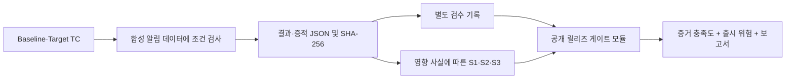

# 공개 TMS 구조와 실행 계약

공개 합성 제품에 대해 TC → 실행 → 증적 → 검수 → 결함 영향 분류 → 게이트를 한 저장소에서 재현합니다.
회사 TMS 서버·DB·UI를 이식한 구조가 아닙니다.

| 경로 | 역할 |
| --- | --- |
| `tms/engine.py` | TC 카탈로그, 합성 실행, 증적 대조, 별도 검수, 게이트 계약 변환 |
| `tms/severity.py` | 고객 영향 기준의 제안 심각도 정책 |
| `tms/__main__.py` | demo / run / review / gate 명령 |
| `modules/release_gate/` | 공개 qa-release-gate의 고정 소스·샘플·테스트 스냅샷 |
| `tests/` | 통합 흐름·심각도·검수·변조·보류 검사 |
| `docs/platform-case-study.md`, `assets/` | 이전 플랫폼 설계·검증 기록과 역사적 캡처 |

루트 명령과 CI는 외부 게이트 저장소를 추가 checkout하지 않습니다.
기존 게이트 파일과 API는 통합 폴더 안에 유지됩니다. [출처·해시 목록](../modules/release_gate/UPSTREAM.md)을 기록합니다.
기존 저장소의 커밋 이력과 공개 주소도 유지하며 리포 삭제·보관 처리나 강제 이력 변경을 하지 않습니다.

## 실제 합성 실행

| 시나리오 | 검사 | 검수 후 결과 |
| --- | --- | --- |
| go | 전체 6건, 경고 2건 및 각 행 warning 확인 | GO |
| conditional | 고의로 필터 결함 주입: 경고 조회에 6건 반환. high 실패 + S2 | CONDITIONAL_GO, 27점 |
| no_go | 고의로 전체 조회에 0건 반환. critical 실패 + S1 | NO_GO |
| insufficient | Target에 가상 환경 장애 주입 | EVIDENCE_INSUFFICIENT |

정적 PASS 결과를 읽지 않고 합성 행의 개수·내용을 비교해 결과·증적을 생성합니다.
제품 실행은 인메모리 Python 함수 호출이며 브라우저 E2E·실서비스·DB·외부 API 실행은 아닙니다.
demo 명령은 네 기대 판정이 일치하면 0으로 종료합니다. 실제 배포 허가가 아닙니다.
`gate --strict`는 GO 0 / NO_GO 1 / 증거 부족 2 / 조건부 수동 보류 3을 반환합니다.

## 검수와 증적 연결

`run.json`에는 범위·결과·분류 근거·준비·조건부 수용·증적 manifest·별도 reviews 목록을 저장합니다.
실행 직후 review는 pending이며 review 명령으로 승인/반려 이벤트가 추가됩니다.
demo는 **명시적인 가상 검수자**로 이 단계를 시뮬레이션합니다. 사람의 실제 검수 완료를 주장하지 않습니다.

검수는 reviews를 제외한 run snapshot SHA-256에 연결합니다. 결과·범위·준비·영향 사실이 바뀌면 이전 승인은 맞지 않습니다.
증적도 해시를 다시 확인하며 누락·변조·실행 폴더 밖 경로는 보류합니다.
실행을 덮어쓰지 않으며 재실행은 새 폴더를 사용합니다. 동일 snapshot에서는 마지막 유효 검수 결정이 적용됩니다.

해시는 인증 서명이 아닙니다. 파일·해시·검수를 모두 다시 쓰면 진위를 증명할 수 없고, 로컬 리뷰어 이름도 인증되지 않습니다.
DB 트랜잭션·동시 쓰기 잠금·사용자 인증·감사 로그 위변조 방지·실제 롤백은 구현 범위 밖입니다.
운영 적용에는 입력 출처와 권한·제품별 핵심 흐름·증적 진위·조건부 승인 인증이 별도로 필요합니다.

## 호환성

[이전 공개 export](../demo/release-gate/synthetic-evidence.json)를 CI에서 통합 게이트로 재생해 CONDITIONAL_GO / 15점 / exit 3을 확인합니다.
CSV 샘플의 NO_GO / exit 1도 기대 결과로 확인하므로 예상 NO_GO가 CI 장애로 표시되지 않습니다.
`modules/release_gate/.github/`는 출처 보존용으로, 자동 실행되는 루트 GitHub Actions 경로가 아닙니다.
별도 qa-release-gate 저장소의 기존 CI 동작은 이번 통합 PR에서 바꾸지 않습니다.
