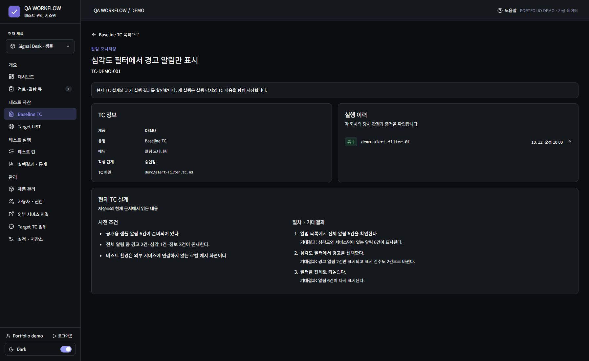
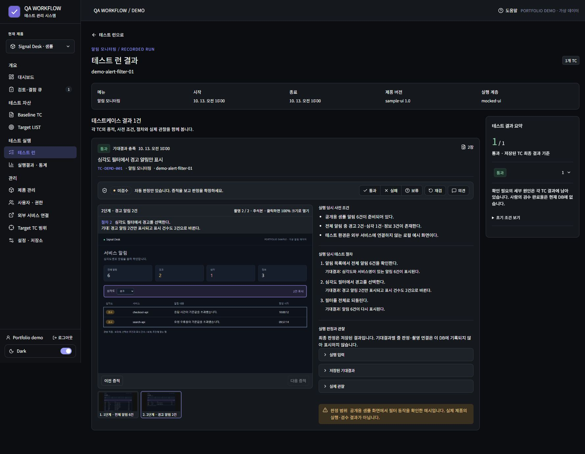
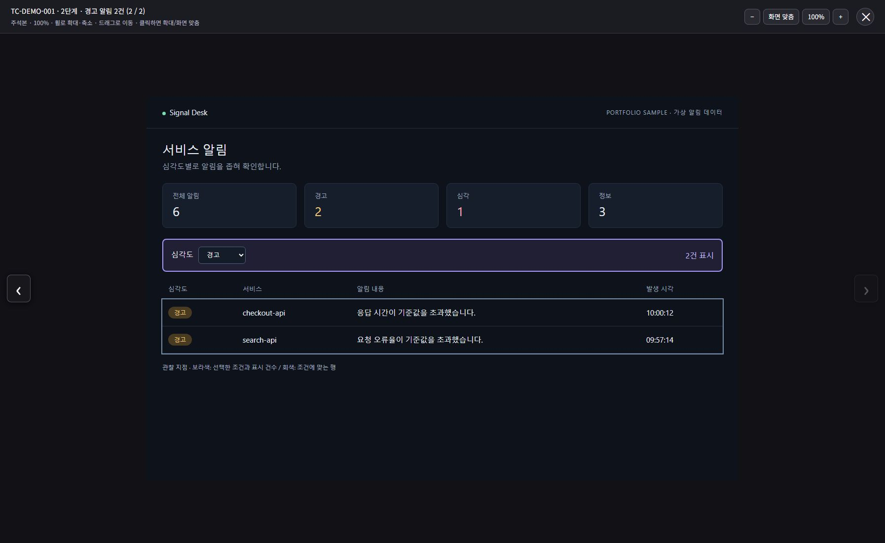
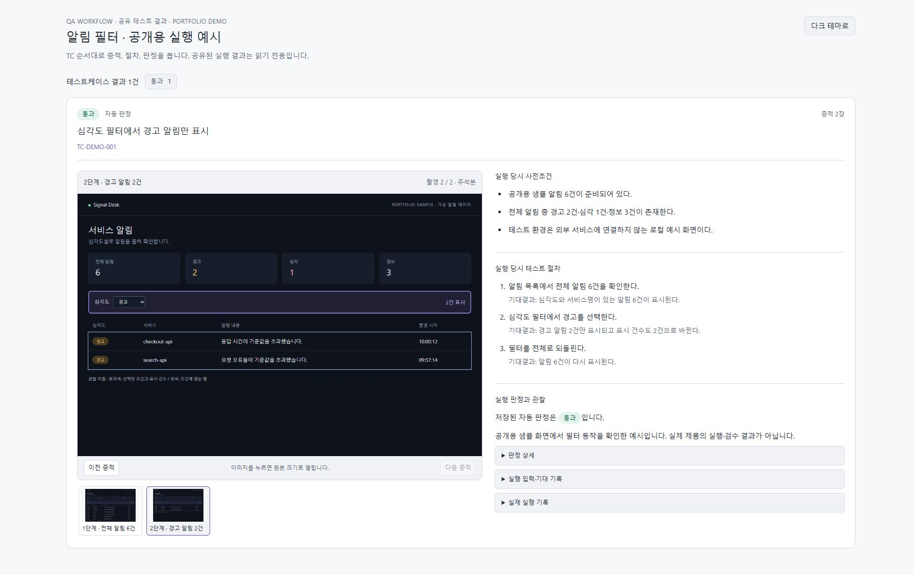
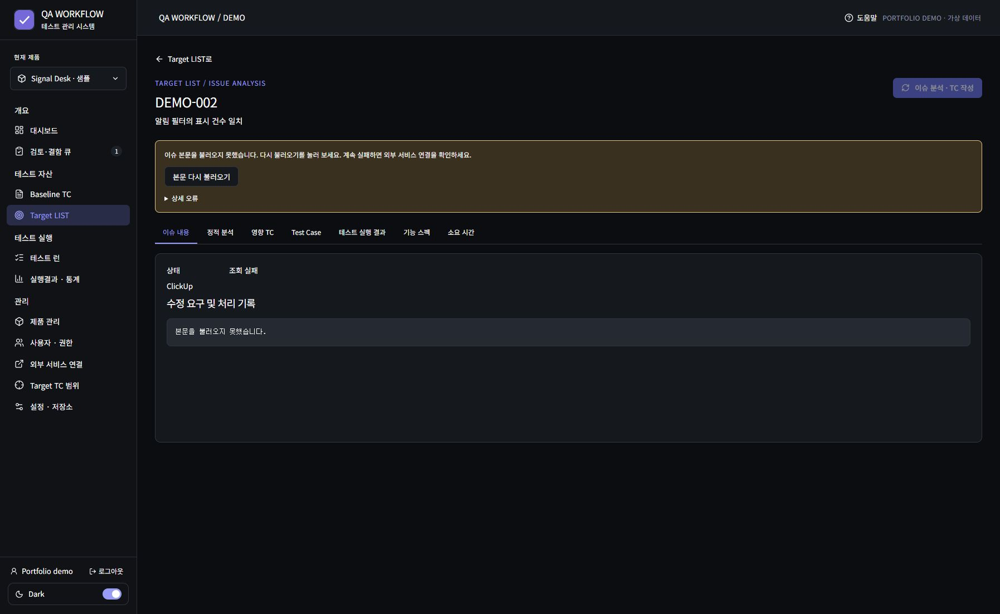
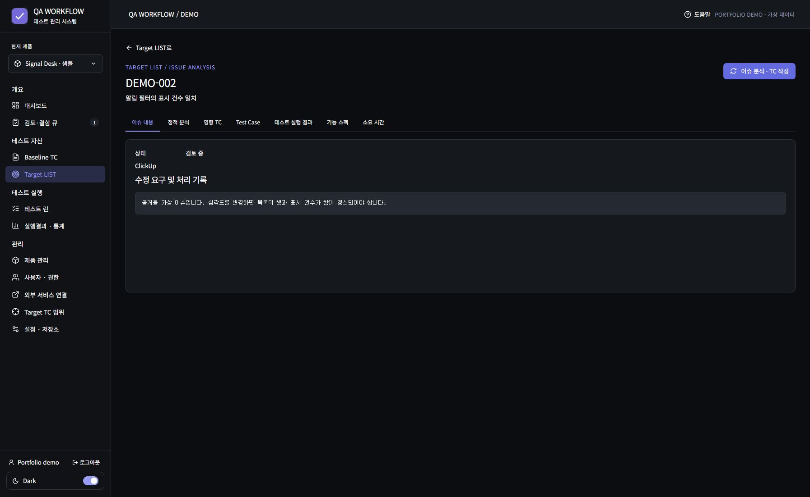

# 화면으로 보는 QA 흐름

[프로젝트 소개](../README.md) · [구현 포인트](engineering-notes.md) · [촬영·검증 범위](verification.md#공개용-화면-촬영--2026-10-13)

테스트 한 건을 **설계 → 실행 기록 → 증적 확인 → 결과 공유**로 따라갑니다. 화면은 로컬 소스의 React 컴포넌트와 공유 결과 렌더러를 실행해 촬영했습니다. 제품명·로고·사용자·이슈·TC·실행 시각은 공개용 예시로 바꿨으며, API와 실행 기록은 가상 데이터입니다.

이 문서의 `PASS`는 실제 제품의 품질 실적이 아닙니다. 증적 속 작은 알림 화면은 이 포트폴리오를 위해 만든 샘플이며, 해당 필터 동작만 코드로 별도 확인했습니다. 사람 검수는 수행하지 않아 결과 카드에 **미검수**로 남겨 두었습니다.

## 1. TC 설계

**확인할 부분:** 사전조건에는 데이터의 개수와 구성을, 절차에는 조작과 기대결과를 짝으로 적었습니다. 오른쪽 실행 이력에서 이 TC의 결과 카드로 이동할 수 있습니다.

| 순서 | 조작 | 기대결과 |
|---|---|---|
| 1 | 전체 알림 조회 | 6건 표시 |
| 2 | 경고 필터 선택 | 경고 2건만 표시, 표시 건수도 2 |
| 3 | 전체로 복구 | 다시 6건 표시 |

**설계 의도:** 현재 TC 설계와 과거 실행 당시의 문서를 구분해야 문서 수정 이후에도 이전 결과를 설명할 수 있습니다.

## 2. 실행 결과와 검수

**확인할 부분:** 자동 판정은 통과여도 검수 줄은 미검수입니다. 왼쪽의 두 번째 증적과 오른쪽 2단계의 기대결과를 비교하고, 입력·기대·실제 관찰 기록을 펼쳐 세부 근거를 볼 수 있습니다.

**설계 의도:** 자동화가 조건을 만족한 것과 담당자가 증적을 검수한 것을 별도 상태로 관리합니다. 캡처 과정에서 판정 저장·재검·댓글 게시 기능은 실행하지 않았습니다.

## 3. 증적 확대와 공유

증적을 확대하면 `경고` 선택값, `2건 표시`, 두 행의 심각도를 함께 읽을 수 있습니다. 샘플의 보라색·회색 경계는 관찰할 영역을 표시합니다. 화면 촬영만으로 통과를 정하지 않고 코드에서 행 개수와 각 행의 심각도를 함께 비교했습니다.

공유 화면에는 결과를 읽는 데 필요한 정보만 제공합니다. 기존 이슈 댓글 형식을 유지하면서 **링크를 누른 뒤 증적과 절차를 확인하는 경험**을 개선했습니다. 이미지 전환·확대가 가능하며 검수 저장 동작은 없습니다.

라이트 테마 보기

## 4. 조회 실패에서 복구까지

목록에서 제목을 받았더라도 상세 본문을 읽지 못하면 **조회 실패**를 표시합니다. 빈 본문과 혼동하지 않도록 안내와 재시도 버튼을 제공하며, 본문이 확보되기 전까지 분석 시작을 제한합니다.

Computer Use로 `본문 다시 불러오기`를 누른 뒤 가상 API가 정상 응답하는 흐름을 확인했습니다. 성공하면 오류 안내가 사라지고 본문이 표시되며 분석 버튼이 활성화됩니다. AI 분석 자체는 시작하지 않았습니다.

이 두 이미지는 **동일한 구현의 실패 상태와 복구 상태**입니다. 과거 버전과 현재 버전을 비교한 이미지가 아닙니다.

## 촬영 방식

- 촬영일: 2026-10-13. 화면에 표시된 실행 시각은 고정된 예시 값입니다.
- Computer Use: TC 실행 이력 이동, 증적 선택·확대·닫기, 공유 화면 테마 전환, 조회 재시도와 브라우저 캡처 7장.
- Playwright: 샘플 필터의 6→2→6건 전환과 각 행의 심각도 검사, 샘플 증적 2장 생성, 원본 UI의 가상 API 연동 검사.
- 로컬 소스는 별도 임시 사본에서 빌드했습니다. 표시 이름·로고·데모 표기를 바꾸고 외부 폰트 요청을 제거했습니다.
- 실제 API·DB·이슈 서비스와 연결하지 않았습니다. 캡처 서버는 로컬 조회만 제공하며 데이터 변경 요청은 거절하도록 구성했습니다.
- 이 공개 저장소에는 검토한 캡처와 설명을 보관합니다. 원본 소스·임시 빌드·내부 증적은 포함하지 않습니다.
